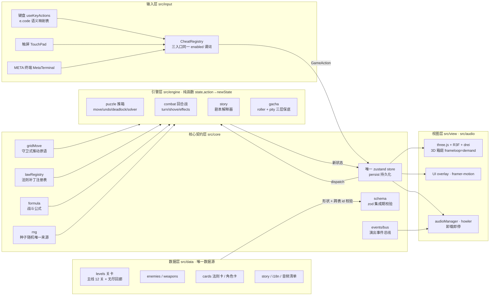

# 法则箱庭异闻录 · Lawbox Chronicle

> **推箱解谜是世界骨架，鬼畜文字冒险是剧情血肉，法则卡实时改写推箱物理与战斗公式。**
> 用一次冒险，改写「注定 abandoned」的 META 结局。

  

把三个废弃老游戏熔成一个连续的 3D 箱庭冒险：

- **SanBPushChest**（推箱子）→ 世界骨架
- **KichikuAdventure**（鬼畜文字冒险）→ 剧情血肉
- **BandoriLotteryEmulator**（抽卡模拟器）→ 法则卡产出

玩家在 3D 箱庭中推箱、战斗、抽卡：抽卡产出的「法则卡」把规则补丁**实时注入**推箱引擎与战斗公式——世界会因为你抽到的卡而改变物理规则。而这一切的终点，是进入那个自称 `This game is abandoned` 的前作彩蛋，在乱码显形的瞬间用原作教过的指令语法反杀剧本，达成真结局。

---

## 目录

- [游戏介绍](#游戏介绍)
- [玩法说明](#玩法说明)
- [技术栈与架构](#技术栈与架构)
- [快速开始](#快速开始)
- [原作修复对照（43 项 bug）](#原作修复对照43-项-bug)
- [未完成功能完成对照（24 项）](#未完成功能完成对照24-项)
- [本轮修复对照（12 项）](#本轮修复对照12-项)
- [数据迁移来源](#数据迁移来源)

---

## 游戏介绍

三个老项目各有一身毛病，也各有一颗好玩的种子：

- 推箱子有完整关卡与解谜骨架，却是「arr 数组 + DOM」双真相源，一推一个幻影箱子；
- 文字冒险有编剧才华（四天使、作者谜题、自称 abandoned 的元叙事彩蛋），却是 22 个 Scanner 抢输入流、格挡公式给玩家回血；
- 抽卡模拟器有真实的概率模型，却整批十连共享一次掷骰、抽完即弃、连退出分支都永不可达。

**法则箱庭异闻录**把三者熔为一体：

1. **骨架**：推箱解谜是世界的物理基础——3D 多高度层箱庭，每个关卡是一块悬浮石板，箱子、怪物、机关都在同一张网格上；
2. **血肉**：鬼畜文字冒险是剧情驱动——原作的主地图、NPC、谜题与 BOSS 连战被重化为剧情事件，散布在箱庭的枢纽关卡与外域；
3. **灵魂**：抽卡产出的「法则卡」实时改写规则——「镜像拉箱」「斜向推挤」「重力井」直接修改推箱引擎的 `RuleSet`，「狂化」「铁壁」直接修改战斗公式参数。你抽到的每一张卡，都在重写这个世界的物理。

而在剧本最深处，那个原作里自称 abandoned、连「胜利」结局都是死亡的前作，被做成了隐藏关：通关演出后解锁游戏内 **META 终端**，输入原作的作弊码链（`/kill--SetName`、`/give--@p--`、`BABA`……）改写结局剧本——把「胜利后仍被乱码杀死」反转为**拒绝剧本**的真结局。

---

## 玩法说明

### 三个老游戏怎么融合

| 老项目 | 在新世界中的角色 | 具体融合方式 |
| --- | --- | --- |
| **SanBPushChest** | 世界骨架 | 推箱关卡是前进方式：把箱子推上旗位开门、铺路、压机关。原作 4 关逐格重化为 3D 关卡，原作「F 键随机换墙皮」升格为阴阳位面切换，原作「撞墙 20 次穿墙术」空壳做成为真机制「相位穿行」 |
| **KichikuAdventure** | 剧情血肉 | 原作 ±5 主地图重化为枢纽关卡「初醒箱庭」（15×13 网格，见 `src/core/store/gameStore.ts` 的 `STORY_GRID_OFFSET` 约定），NPC 对白、四天使、作者谜题、BOSS 连战全部成为剧情事件；原作彩蛋前作（EasterEgg）成为隐藏关与 META 终端 |
| **BandoriLotteryEmulator** | 法则卡产出 | 抽卡是成长系统：星石（战斗/解谜/剧情产出）抽卡，法则卡注入规则。原作概率模型被原样保留为「怀旧模拟池」——一个可游玩的概率对照展品 |

核心循环：**探索箱庭 → 推箱解谜 / 布阵战斗 → 获得星石与卡 → 抽法则卡 → 世界规则被改写 → 解锁更远的区域与更深的外域 → 通关 → 解锁 META 终端 → 改写结局**。

### 键位表

| 按键 | 动作 |
| --- | --- |
| `W` `A` `S` `D` / 方向键 | 移动 / 推箱（布阵战阶段 = 推挤敌人方块） |
| `Shift` + 方向键 | **镜像拉箱**（需「法则·镜像拉箱」） |
| `Y` `U` `B` `N` | **斜向推挤**（↖↗↙↘，需「法则·斜向推挤」） |
| `C` | **相位穿行**（沿最近一次移动方向穿墙一格，需「法则·相位穿行」且有充能） |
| `Tab` | 切换布阵模式 |
| `F` | 阴阳位面切换（需「法则·位面通行」；持「位面之眼」可任意位置切换） |
| `E` | 交互 / 推进对话 |
| `Enter` / `Space` | 推进对话 |
| `Z` | 撤销一步 |
| `Q` | 重玩本段 |
| `M` | 静音 |
| `` ` ``（反引号） | 打开 / 关闭 META 终端 |
| `Esc` | 关闭浮层 |

键位唯一来源 `src/input/useKeyActions.ts` 的 `KEY_CODE_TO_ACTION`（按 `e.code` 建表），键位语义与触屏 `TouchPad` 同源归一为 `GameAction`（`src/core/types.ts`）。

### 新玩法清单

1. **法则卡改写系统（核心融合玩法）**：抽卡产出的「法则卡」把规则补丁实时注入推箱引擎 `RuleSet` 与战斗公式参数——如「镜像拉箱」「斜向推挤」「箱可推离基座」「伤害=攻-防 改为 攻/2」。补丁注册表见 `src/core/lawRegistry.ts`（17 个已注册补丁 id，`applyPatch` 为纯函数）。法则卡获取有三层保险保证零软锁（十连 3★ 保底 / 50 抽硬保底 / 40 抽法则定向保底 + 碎片直购，见 `src/engine/gacha/pity.ts`）。
2. **布阵推挤战**：战斗前置「布阵阶段」，怪物方块化（重量∝HP）在 3D 战斗网格上可被推挤——推下深渊/推进尖刺按比例扣血甚至秒杀小怪，BOSS 免疫推挤必须走公式战。推箱技巧第一次成为战斗资源（`src/engine/combat/shove.ts`）。操作：布阵期方向键/WASD 或战斗面板方向钮推挤；`Tab` 切换布阵模式；战场尖刺格由关卡图例 5 现算、深渊格由 `battleHazardsFor` 生成，3D 舞台按 `hazardCells` 渲染（`src/view/ui/CombatPanel.tsx` + `src/view/three/GridArena.tsx`）。
3. **立体推箱与箱落攻击**：推箱从平面升级为多高度层 3D（坡道/落差），把箱子推下高台可砸伤下方敌人、压碎尖刺、触发机关——地形本身成为武器（`src/engine/puzzle/grid.ts` 高度语义）。
4. **阴阳位面**：SanBPushChest 的「障碍物定时随机变换」升格为玩法机制——世界有阳/阴两面，F 键切换位面（需「位面通行」法则卡解锁），部分石板/道路/机关仅阴面存在。14 张原作墙皮资产成为阴面随机墙皮；状态驱动按需渲染，无常驻定时器。
5. **相位穿行**：原作撞墙 20 次的空壳「穿墙术」（注释自认『不想做了』）做成为真机制——消耗穿行充能穿过一格障碍，充能由法则卡与解谜评分供给（`phaseWalkCharges` 字段，`src/core/lawRegistry.ts`）。
6. **META 终端与真结局**：原 EasterEgg 自称 abandoned 的前作变成隐藏关（`src/data/story/hiddenGame.ts`）；通关演出后解锁游戏内终端（`src/input/MetaTerminal.tsx`），输入 `/kill--SetName`、`/give--@p--`、`BABA` 等原作弊码链改写结局剧本，把「胜利后仍被乱码杀死」反转为拒绝剧本的真结局。
7. **怀旧模拟池与概率实测曲线**：内置复刻 BandoriLotteryEmulator 原始概率模型（单 roll 十连 4★6%/3★26.05%、每第 10 回 0.3/0.5，含原作全部概率缺陷）的「怀旧池」与正式逐卡池并列，图鉴页给出双池出货实测曲线——旧 bug 变成可游玩的概率对照展品（`src/data/gacha/pools.ts` + `src/archive/statsCollector.ts`）。档案面板「双池曲线」页签有一键「跑一回怀旧对照十连」入口（`src/view/ui/ArchivePanel.tsx`）。
8. **无尽回廊**：东侧外域为程序生成关卡（逆向拉箱生成，可解性由构造保证；生成后仍经内置 A*/BFS 求解器求解最短推数并逐格回放验证，双重闸门），兑现 mapGenerator.js 文件名从未兑现的承诺（`src/data/levels/endless.ts`）。
9. **本轮新接线的六张法则卡与三种新动作**：`src/data/cards/lawCards.ts` 原「请求发行」清单 6 个补丁全部发行——「镜像拉箱」（Shift+方向拉箱）、「相位穿行」（C 键穿墙）、「箱落引爆」（箱落清除落点四邻）、「位面之眼」（任意位置切位面）、「击退+2」「爆炸+1」，与既有的「斜向推挤」「箱可推离」合计 8 张谜题侧卡全部进池并各配关卡奖励（`src/data/levels/areas.ts` 的 `reward.lawCardId`），法则卡总数 17 张。对应三种新动作 `pull` / `diagonal` / `phase` 已在 `GameAction` 契约与 `useKeyActions.ts` 键位表落地（键位见上表）。
10. **碎片直购与祭坛商店**：重复法则卡自动转 20 碎片，60 碎片可在祭坛商店直购任一未持有法则卡（`src/engine/gacha/pity.ts` + `src/view/ui/ShopPanel.tsx`），与三层保底构成零软锁兜底。
11. **选关面板与档案面板**：HUD 右上「🗺」进入选关面板（列出关卡与 reached/cleared 进度，已到达可直接进入，`src/view/ui/LevelSelectPanel.tsx`）；档案面板（图鉴 / 成就 / 双池曲线 / 逐抽记录，`src/view/ui/ArchivePanel.tsx`）消费 `logbook` 与 `statsCollector` 两个持久化分片。

---

## 技术栈与架构

### 技术选型（每一项都是对三个老项目教训的回应）

| 技术 | 选择理由（对应根治的老问题） |
| --- | --- |
| **React 18 + TypeScript + Vite** | 标准构建链，替代三个老项目各自为政的零构建/裸 script 体系（BandoriLotteryEmulator 连 MANIFEST/构建脚本都没有） |
| **zustand + persist 中间件** | 单一 store 即单一真相源——这是 SanBPushChest「arr 数组+DOM 双真相源」这一大半 bug 根源的架构级根治；同时补上三项目均缺失的持久化（原作解锁状态、彩蛋计数、语言选择刷新即丢） |
| **three.js + @react-three/fiber + @react-three/drei** | 声明式 3D 与 React 状态同源；drei 的 OrbitControls/Instances/Html 覆盖视角旋转、合批渲染与 3D 标注。3D 场景 `frameloop="demand"`：静置零渲染，状态变化才 invalidate（根治原作常驻 50ms 闪烁定时器） |
| **framer-motion（overlay）/ useFrame（3D）** | overlay 动效走 framer-motion（抽卡翻牌演出、模态转场）；3D 内动效走 R3F 的 `useFrame`，两者各司其职 |
| **howler.js** | 音频资源经 import 由打包器解析，BGM/SFX 挂 React 生命周期、卸载即停——一次性消灭三类音乐 bug：KichikuAdventure 非守护线程挂死、BandoriLotteryEmulator 异常 `System.exit` 杀主线程、SanBPushChest 首键 go 门槛无声 |
| **zod** | 关卡/卡池/事件表的 id 引用在集成期校验（发卡→法则补丁、掉落→武器、事件→敌人、音频→文件），「README 与代码系统性不一致」类问题无处藏身 |
| **vitest** | 引擎层纯函数可脱离 React 单测。当前 31 个测试文件 / 474 个用例，含主线 12 关离线可解性常驻门 |

### 架构图



### 目录结构（四层分离，模块间只经显式接口与状态交互）

```
src/
├── core/            # 跨模块契约（改这里 = 改全员契约）
│   ├── types.ts          # 共享类型唯一源
│   ├── schema.ts         # zod 数据校验 + 集成期跨表 id 引用一致性
│   ├── rng.ts            # 种子随机（引擎唯一随机来源，禁 Math.random）
│   ├── formula.ts        # 战斗公式（格挡=减免、伤害下限 1、永不回血）
│   ├── gridMove.ts       # ★共享网格推动原语（守卫先于索引访问的唯一实现）
│   ├── lawRegistry.ts    # ★法则补丁注册表（字符串 id → 效果的所有权归 core）
│   ├── events/bus.ts     # 类型化演出事件总线（音效/震屏/运镜不进状态）
│   └── store/            # 唯一 zustand store（persist）+ selectors 派生现算
├── engine/          # 引擎层：纯 TS、零 React、(state, action) => newState
│   ├── puzzle/           # move / undo 撤销栈 / deadlock 死角 / solver 求解器
│   ├── combat/           # turn 回合 / shove 推挤 / effects 击退等
│   ├── gacha/            # roller 逐卡 roll + pity 三层保底 + 碎片经济
│   └── story/            # interpreter 剧本解释器 + triggers
├── data/            # 唯一数据源：关卡/敌人/武器/卡池/剧情/作弊表/i18n/音频清单
├── view/            # 视图层：R3F 3D 箱庭 + UI overlay（framer-motion）
├── audio/           # audioManager（howler 唯一封装）+ BGMController 挂载点
├── input/           # 输入层：键盘/触屏/META 终端归一为语义 GameAction
├── archive/         # statsCollector 抽卡曲线 / logbook 战斗日志（独立 persist 分片）
└── assets/          # 三老项目搬运素材（图 32 + 音效 20 + BGM 2 + .mid 原件 2）
```

关键不变量：

- **单一真相源**：一切游戏状态在 `core/store/gameStore.ts` 的唯一 store 中；`segment`/`combat` 等旧形状读点是单向投影，永远只在该状态写入的同一 `set()` 里重算，不是第二真相源。
- **守卫先于索引**：全项目唯一网格索引点是 `core/gridMove.ts` 的 `cellAt`/`isInside`，越界是显式 `{ ok: false }`；配合 `tsconfig.app.json` 的 `strict` + `noUncheckedIndexedAccess`，靠 JS 越界返回 undefined 兜底的写法在类型层就不可能。
- **引擎纯函数**：`engine/` 四个引擎零 React 依赖，action → 纯函数 → 新状态，vitest 直接覆盖（当前 474 用例）。
- **演出与状态分离**：音效/震屏/粒子一律经 `core/events/bus` 广播，不进状态机。

---

## 快速开始

```bash
npm install        # 安装依赖
npm run dev        # 开发服务器（Vite 默认 :5173）
npm run build      # tsc -b && vite build，产物为纯静态站点（dist/）
npm run test       # vitest run（jsdom 环境）
npm run test:watch # vitest watch
npm run preview    # 预览 dist/ 构建产物
```

本文档撰写时的实测记录（在本仓库根目录执行）：

| 命令 | 结果 |
| --- | --- |
| `npm run test` | ✅ 通过：**31 个测试文件 / 474 个用例全绿**（67.3s），含主线 12 关「零法则可解」离线校验门与逐格回放验证 |
| `npm run build` | ✅ 通过：`tsc -b && vite build` 成功（5.75s），产物含三套 BGM、20 个音效与全部贴图 |
| `npm install` | 未实跑（本机 `node_modules` 已存在）；为标准安装命令 |
| `npm run dev` | 未实跑（常驻开发服务器，不便在文档流程中启动）；脚本已定义于 `package.json` |

---

## 原作修复对照（43 项 bug）

> 三个原仓库的实测 bug 清单全量收录如下。编号规则与代码内注释一致：
> **K** = KichikuAdventure（16 项），**S** = SanBPushChest（18 项），**B** = BandoriLotteryEmulator（9 项）。
> 「本作处置」列指向本仓库中落实修复的机制与文件。

### KichikuAdventure（16 项）

| # | 问题 | 原作位置 | 原作表现 | 严重度 | 本作处置 |
| --- | --- | --- | --- | --- | --- |
| K1 | BOSS 战「格挡」数学漏洞：BOSS 攻击归零后格挡公式变成给玩家回血，BOSS 战不可能失败 | `Game.java:1823`（公式 `you.setHp(hp - ylzz.getAttack() + you.getDefense())`），配合 `Game.java:495`（谜题答对 `ylzz.setAttack(0)`） | 触发条件：答对作者谜题后进 BOSS 战。BOSS 攻击=0，玩家被「格挡」时实际 -0+10=回 10 HP（上限截断 100）。实测通关日志：42→52→62→72→82→92→100，同时日志自证「造成了 0 点伤害！但 TestPlayer 格挡了一部分伤害！」 | high | `formula.resolveStrike`：格挡=减免、伤害下限 1，`clampHp` 双向截断永不加血（`src/core/formula.ts`），单测锁死 |
| K2 | 逃跑的 `x++` 是 Java 值传递空操作，玩家逃跑后仍站在怪物格子上（README 宣称的位移不存在） | `Game.java:998/1004/1007、1225/1230/1234、1476/1481/1485`（`printDialogue(int x,int y,...)` 形参为原始类型拷贝） | 触发条件：任意战斗选 2 逃跑或输入非法选项。实测：在 (3,-3) 遇郭老师选 2，「你逃跑了。」后主循环打印坐标仍是 (3,-3)。副作用轻微（再走一步就脱离），但 README.md:12 描述的逃跑位移机制实际不存在 | medium | 移动即 `action → 纯函数 → 新状态`（`src/core/store/gameStore.ts`），位移真实生效；逃跑为战斗引擎显式动作 |
| K3 | 越界缓冲区(\|6\|~\|7\|)内输入 exit/d/任何非 wasd 内容不会退出游戏而是执行 `x++` | `Game.java:285-307`（whattodo 只识别 w/s/a，else 分支 302-307 无条件 `x++`） | 触发条件：坐标越出 ±5 后在缓冲区输入 'exit'。与 README.md:10「可以随时在移动时输入 exit 退出」矛盾，exit 被当成向右移动 | medium | 键盘按 `e.code` 语义映射建表，未知输入一律走 META 终端回显，结构上不可能被解释为移动（`src/input/useKeyActions.ts`） |
| K4 | 越界小循环每轮 `new Scanner(System.in)` 与外层 move Scanner 抢 token，管道/粘贴输入下抛 NoSuchElementException 崩溃 | `Game.java:285-286`（实测异常栈：`java.util.NoSuchElementException at me.emilelu.KichikuAdventure.Game.main(Game.java:286)`，两次复现） | 触发条件：流式输入时下一个 token 已被外层 move Scanner 消费/缓冲，`whattodo.next()` 读到 EOF 即崩；交互式逐键输入不触发。main 崩溃后 JVM 因非守护 BGM 线程仍挂死（实测 EXIT=124 被 timeout 杀掉） | medium | 浏览器事件模型无共享输入流；键盘唯一事件源 `useKeyActions`，不存在第二输入消费者 |
| K5 | EOF/异常退出后 JVM 永不结束：BGM 线程非守护且 `Music.isEnd` 无任何调用方 | `Music.java:53`（`while(isEnd==0)`）+ `Music.java:24`（setIsEnd 定义后全项目 grep 0 调用）+ `Game.java:7-14`（playMusic 默认非守护线程） | 触发条件：stdin EOF（Ctrl+D/关闭管道）或 printDialogue 内任何未捕获异常。实测：喂完姓名性别后 EOF，进程 15 秒后仍存活，被 timeout 以 EXIT=124 杀死。所有正常退出全靠 `System.exit(0)` | medium | 无常驻线程；Howl 实例统一持有，`dispose()` 卸载即停（`src/audio/audioManager.ts`） |
| K6 | 全项目 22 个 Scanner 共享 System.in 且从不关闭，首个 Scanner 缓冲会吞掉后续全部输入导致后续 Scanner 永久阻塞 | `Game.java` 10 处（23/84/285/489/928/932/1155/1159/1407/1411）、`EasterEgg.java` 12 处（80/95/112/117/123/131/135/139/147/161/168/189）；`@SuppressWarnings("resource")`（Game.java:17/323）仅压警告 | 触发条件：输入快于消费（粘贴/管道/脚本）。实测第一次全量跑：Game.java:23 的 Scanner 一次性缓冲了整个输入文件，Game.java:84 的 move Scanner 阻塞在「现在，你可以开始移动了。」后永远收不到输入。交互逐键可侥幸工作，属结构性资源/输入缺陷 | medium | 输入层唯一事件源（`src/input/useKeyActions.ts` + `TouchPad.tsx`），多处 Scanner 抢占输入的结构不存在 |
| K7 | 武器选择边界检查 off-by-one：允许输入 `bag.size()+1`，触发 IndexOutOfBoundsException 被吞成「逃跑」 | `Game.java:934/1161/1413`（`atglsR <= bag.size() + 1` 应为 `bag.size()`）→ `Game.java:936/1163/1415` `bag.get(atglsR-1)` 越界 → 外层 catch（1010/1237/1488）捕获 | 触发条件：战斗中武器序号恰好等于背包数+1。实测：bag=[匕首] 时输入 2，输出「你因为某些原因逃跑了，害。」而非提示无效，玩家不知发生了什么 | low | `noUncheckedIndexedAccess` 全开 + 守卫式访问，越界选择在类型层不可能（`tsconfig.app.json:26`）；选择项由 zod 校验的数据表驱动 |
| K8 | 武器攻击加成按背包下标到 weasum 固定列表取值，作者清空背包后下标错位（当前路线靠 BOSS 战硬编码而未爆发） | `Game.java:940/1167/1419`（`weasum.get(atglsR - 1)`）；`Game.java:497-500` `bag.clear()` 后 bag=[爷爷的拐杖] 而 `weasum.get(0)`=匕首 | 触发条件（潜伏）：任何在 `bag.clear()` 之后发生的常规战斗会拿到错误武器数值。当前唯一后续战斗是 BOSS（Game.java:1612-1616 硬编码拐杖、无下标查找）所以未触发；改动剧情或加战斗即踩雷 | low | 武器与加成数值单表声明（`src/data/weapons.ts`），不存在可错位的平行列表；zod 集成期校验形状与引用 |
| K9 | 战斗胜负结算 message 依赖 finally 块，但玩家死亡走 `System.exit(0)`，finally 不执行；HP 无下限截断，击杀溢出显示负血 | `Game.java:988-996/1216-1223/1467-1474/1841-1860`（finally）、965/1193/1444/1810（System.exit）；无 0 值截断仅上限截断（954-956/974-976 等） | 触发条件：任何击杀。实测日志：「蔡徐坤 现在的血量是 -20」、郭老师 -10、冬泳怪鸽 -31、BOSS -157；玩家死亡路径不打印结算。表现问题，不影响逻辑正确性 | low | 结算为纯函数返回 `StrikeResult` 而非 finally 文案；`clampHp` 下限 0 上限 maxHp，负血不可表达（`src/core/formula.ts`） |
| K10 | BOSS 分身数无界翻倍，long 溢出后打印负数分身 | `Game.java:1614`（`long shadow = 2`）、1828（`shadow = shadow * 2`） | 触发条件：BOSS 战拖过约 62 次「玩家格挡 BOSS」（实测 OvTest：62 次翻倍后 shadow=-9223372036854775808）。极端回合数下触发（全格挡 10 伤/回合需 234 回合），纯表现层 | low | 结算数值由 `engine/combat` 纯函数产出（TS number 语义 + 单测），无 long 累乘溢出语义 |
| K11 | `Music.Play` 静默吞异常 + `Music.Stop()` 对未初始化 midi 直接解引用 → NPE 风险；BGM 路径硬编码相对路径 | `Music.java:39-40`（空 catch）、43-49（Stop 不判空）、16-18（`new File("src/me/emilelu/KichikuAdventure")`）；`EasterEgg.java:220-221`（连调两次 Stop()） | 触发条件：工作目录不在项目根/两个 mid 未复制（README.md:5 自己承认此风险）→ Play 失败 midi=null → EasterEgg 到达 Horrible Atmosphere 时 Stop() 抛 NPE，且 BGM 静默消失无任何提示 | low | 资源 URL 构建期解析（`import.meta.glob`），加载/播放失败记入错误队列并广播 toast，绝不静默（`src/audio/audioManager.ts`） |
| K12 | BOSS 战战前「请选择武器」是假的：打印选项但不读任何输入，武器硬编码 | `Game.java:1611`（getBag）→1612（硬编码「你选择了爷爷的拐杖！」），与 `Game.java:1609`「逃跑(被禁用)」一样无输入校验 | 触发条件：BOSS 战开始时玩家按提示输入序号 → 输入滞留缓冲区，战斗结束后被外层 move Scanner 当移动指令消费（输入'1'会得到「输入的内容不合法」） | low | BOSS 走统一战斗管线（`src/engine/combat/`），武器为背包真实条目的显式选择，与常规战斗同一套代码 |
| K13 | EasterEgg 谎报「背包已清空」：打印 `[System] weaponList has been cleared.` 但代码从未 clear | `EasterEgg.java:183-185`（gethasWeapon 被注释 'REMOVE BY BOSS'，打印 cleared 消息）；grep 全文无 `weaponList.clear()` | 触发条件：彩蛋 BOSS 战前必现。数据与文案不一致；`weaponList.get(1)/get(2)`（199/205）依赖玩家走过完整收集路线才不越界 | low | 文案与状态同源于 store：隐藏关剧本真实结算 `clearFlagsWithPrefix('hg:weapon')`（`src/data/story/hiddenGame.ts`） |
| K14 | README 与代码系统性不一致：武器数值、作者坐标、越界阈值三处全对不上 | README.md:24-28（10/30/50/123/188）vs `Game.java:61-65`（20/50/80/188/233）；README.md:16 作者@(4,2) vs `Game.java:52` 作者@(-2,4)（且与 README.md:18 蔡徐坤坐标重复）；README.md:30-33 越界阈值 8 vs `Game.java:121/127/134/139` 的 7（实测 (0,7) 不触发彩蛋、(0,8) 触发） | 照 README 写攻略的玩家会被误导；README 战斗流程描述（逃跑位移）也与实测行为不符 | low | 数据外置 `src/data/` 唯一数据源 + zod 跨表 id 引用校验（`src/core/schema.ts`），vitest 集成期常驻，文档与数据无从分叉 |
| K15 | `EasterEgg.main` 从 Game 返回后主流程穿透继续执行（代码假设彩蛋必 System.exit） | `Game.java:121-125`（独立 if 非 else-if，`EasterEgg.main(args)` 返回后顺序落入 127/134/139 判断再落到 282 越界警告） | 触发条件（边缘）：EasterEgg 的 `while(s.hasNext())` 在 EOF 时正常返回。实测输出：彩蛋「请输入你的名字：」之后直接打印 Game 的「警告：你正在试图越界」，随后 whattodo NoSuchElementException 崩溃（Game.java:286） | low | 剧本为显式节点图（`src/engine/story/interpreter.ts`），含全部死亡分支且都是 closable 终局，结构上不存在顺序穿透路径 |
| K16 | 彩蛋随机伤害可为负数；BOSS 秒杀伤害先按 int 乘再拓宽 long（当前值安全、latent） | `EasterEgg.java:98`（`(int)(Math.random() * Caixukun.hp - 2)` ∈ [-2,2)，可打印「造成了 -1 点伤害」，下一行玩家必死）；`Game.java:1602`（`long attack = ylzz.getAttack() * 3`，int 乘法先行，233666438*3=700999314 未溢出） | 触发条件：彩蛋选 1 攻击且 roll 到低值；调大 BOSS 攻击数值后 1602 会 int 溢出。均为边缘表现问题 | low | 随机唯一来源为注入式种子 Rng（`src/core/rng.ts`，禁 `Math.random`）；伤害公式下限 1（`src/core/formula.ts`） |

### SanBPushChest（18 项）

| # | 问题 | 原作位置 | 原作表现 | 严重度 | 本作处置 |
| --- | --- | --- | --- | --- | --- |
| S1 | 作弊4「飞箱子」后原格子残留幻影箱子：arr 旧格仍为 4，箱子元素的 cRow/cCol/id 均未更新 | `libs/js/mapGenerator.js:160-173`（flags.onclick 只改 style.left/top 并把旗格写 1，未清理箱子旧格） | 解锁 completed 后点箱子再点旗子：箱子飞走但原格 arr 仍=4，角色走向原格会撞「空气墙」（播放撞击音不动）；更严重的是 move.js:19 会按旧坐标 getElementById 找到这个已被移走的箱子元素并「推」它——箱子会从旗子上瞬移回网格，且旗格保持 arr=1 被永久视为已覆盖，状态与画面完全脱节 | high | 实体数组唯一真相，占位关系由 selectors 现算（`src/core/store/`）；任何位移改实体本身，无「格子残留」可发生 |
| S2 | `nowSelectedChest` 跨关卡悬挂引用：`start()` 不清空选中状态 | `libs/js/start.js(service.js):99-110`（start() 重置了 statusNow 但没重置 nowSelectedChest/nowSelectedFlag）；`mapGenerator.js:162,192-196` | 在 A 关点了箱子选中（作弊4 第一步）后用 Q/T/选关换到 B 关，nowSelectedChest 指向已从 DOM 摘除的旧元素；此时点击 B 关任意旗子会通过 `nowSelectedChest != undefined` 判断（mapGenerator.js:162），把旗格 arr 写成 1——旗子被一个看不见的「箱子」覆盖，可造成假过关或永久堵路 | medium | 关卡切换重建纯数据状态，不存在跨关 DOM 引用；撤销快照为值拷贝、不共享可变结构（`src/engine/puzzle/undo.ts`） |
| S3 | 箱子被推向上下边界时走异常路径而非边界守卫：越界数组访问先于边界判断执行 | `libs/js/move.js:21-22`（`arr[oCase.cRow + t][oCase.cCol + l]` 先求值）与 24-30（offSet 守卫在其后） | 箱子在 row 0 或 row 12 被继续向上/下推时，arr[-1]/arr[13] 为 undefined，`undefined[col]` 抛 TypeError（已用 node 实证：`a[-1][0]` 抛 TypeError，`a[0][-1]` 返回 undefined 不抛）——左右越界走 move.js:24-30 的正常 return，上下越界走异常路径：键盘触发时被 keyDown 的 catch 吞掉并刷控制台（service.js:93-95），点虚拟方向键触发时则是未捕获异常；两者都不产生状态破坏但行为路径不一致，且 move.js:24-30 的守卫对上下方向形同虚设 | low | 全项目唯一索引点 `gridMove.cellAt`：Result 式守卫先于一切索引访问，四方向行为一致（`src/core/gridMove.ts`） |
| S4 | 箱子落到旗子上后该格写为 1（墙），箱子永久锁死、角色不可通行，与标准推箱子语义相悖 | `libs/js/move.js:46-50` | 箱子推上旗后 arr 变 1：该箱永远无法再推走；该格对角色成为不可通过的墙。若过早把旗格堵在必经走廊上，可把关卡玩成死局（无法反悔，只能 Q 重开）；同时 check() 以「无 3」判胜，被堵死也毫无提示 | medium | 落位箱仍是实体而非墙格（就位=语义状态）；`deadlock.ts` 静态死角检测 + 撤销栈可反悔，死局有提示可回退 |
| S5 | `changeRole` 旋转整个 roleImgs 数组，破坏方向贴图映射 | `libs/js/easterEgg.js:29-30`（push+shift 旋转全数组）；roleImgs 定义 `libs/js/start.js:11-21`，其中 0-3 位是 w/a/s/d 方向箭头、4-8 位才是角色皮肤，被 up/down/left/right 直接按位引用（move.js:61,66,71,76） | 按一次 R 换角色：角色脸变成方向箭头、且四个移动方向显示的箭头全部错位（如向下移动显示 w 图）；按满 4 次皮肤才轮到 roleImgs[0]，方向映射依旧错乱。设计意图（换 5 种皮肤）与数据结构（方向/皮肤混用一维数组）冲突 | medium | 皮肤与方向贴图在数据层分表声明，渲染是状态纯投影，运行时改表的结构不存在 |
| S6 | `cheat()` 的双定时器泄漏与 removeIng 卡死 | `libs/js/cheat.js:10-29`（rr 每 100ms 调 cheat2，sds 轮询 currentChests.length==0 才清理并复位 removeIng） | E 触发删箱循环期间若玩家正常推箱过关（statusNow 变 true，cheat.js:39 的守卫让 cheat2 变空转），currentChests 永远不归零：rr+sds 两个 interval 以 100ms 频率空转直到刷新页面，且 removeIng 恒为 true，本关内再按 E 直接 return（cheat.js:31-33） | medium | 引擎与视图零业务 `setInterval`；墙皮/特效类重掷为按需一次性的 epoch 自增（`src/input/cheatRegistry.ts`） |
| S7 | `cheat()` 入口的关卡判断条件恒真：`level != arr.length` 用行数(13)比关卡号(0-3) | `libs/js/cheat.js:7` | 该条件永远为 true，属于死代码；从上下文看本意应是 `level != init().length - 1`（判断是否最后一关），写错后恰好无副作用，但说明该分支从未被真正验证 | low | 作弊/命令表为纯数据声明 + 统一注册执行，无手写分支死代码（`src/data/cheats/commands.ts`） |
| S8 | cheat2 对「箱子已在旗子上」的处理留下永久隐形墙 | `libs/js/cheat.js:45-47`（同格时 `arr[theChest.cRow][theChest.cCol] = 1`，随后 51-54 行把旗和箱 DOM 都 removeChild） | 用 K/作弊2 删掉一对已配对的箱+旗后，画面上两者消失，但该格 arr 恒为 1：角色从此永远走不上去，也无任何视觉提示（当前数据下不影响判胜，因为判胜只看旗是否清空） | low | 删除配对即删实体，网格与实体同源于唯一 store，无残留格可遗留 |
| S9 | 键盘作弊热键全部绕过 README 宣称的解锁门槛 | `libs/js/service.js:60-63`（K→cheat2）、:68（R→changeRole）、:69（E→cheat）、:74-77（T）——均无 completed/notToL2 判断；对照 README.md:16,24,28 | README 称作弊2~4『第一次通关后解锁』、角色切换需点击20次或二周目、选关在第一次到第二关解锁；实际游戏一开始按 K 即可删箱、按 R 即可换肤、按 E/T 即可跳关，解锁机制只约束了鼠标入口（cheat.js:78-79、mapGenerator.js:123/162/193 的 completed 守卫） | low | CheatRegistry：键盘/面板/终端三入口过同一 `enabled()` 谓词，热键不再自带判断（`src/input/cheatRegistry.ts`） |
| S10 | 选关下拉的解锁条件与 README 不符：任意一次 nextLevel 调用都会解锁，而非「第一次到第二关」 | `libs/js/level.js:21-25`（`if (notToL2) { mySelect.disabled=''; ... }` 不检查 level 值） | 在第 1 关按一次 Q（重玩）或 T，下拉框立即解锁，README.md:16 的『在玩家第一次到第二关时解锁』未按字面实现（notToL2 变量名暗示本意是判断到达第 2 关，条件写丢了） | low | 解锁条件为显式谓词数据 `reached-level`，读 store 内 `reached:<levelId>` 旗标，与 UI 提示同源（`src/data/cheats/commands.ts`） |
| S11 | 最终关通关后控制权被锁死，唯一恢复入口是「点一下选关下拉」且无任何提示 | `libs/js/level.js:55-68`（终局时隐藏全部 span、把 document.onkeydown 换成「仅关闭弹窗」）；恢复逻辑在 `cheat.js:69-79`（mySelect.onclick 内） | 通关第 4 关并关掉弹窗后：所有热键（M/L/K/E/Q/F/R/方向键）全部失效，控制按钮隐入透明（.hide），玩家只能盲猜去点选关框才能恢复操作并解锁二周目；语言下拉/音量虽可用但状态栏仍停留在『GAME OVER』 | medium | 终局为 closable 模态（`src/view/ui/ResultModal.tsx`），关闭即恢复操作，控制权不没收；设置抽屉随时可用 |
| S12 | 箱子与旗子共用 `row,col` 作 DOM id，产生重复 id | `libs/js/mapGenerator.js:157`（flags.id=row+','+col）与 :187（oCase.id 同格式），move.js:43 推箱时改写箱子 id | 箱子被推上未被覆盖的旗子时，箱元素与旗元素同时持有相同 id（invalid HTML）。当前代码因该格 arr 变 1 不会再触发按 id 查找，属潜伏隐患；一旦后续改动允许再推/查找即会命中错误元素 | low | 无 DOM id 寻址：实体按 id 在状态中查找，DOM 只做渲染投影 |
| S13 | `playSoundEffect` 的 go 门槛导致首次按键前点击 notice 无声，且每次播放都重设 src | `libs/js/service.js:3-12`（go 初始 false，仅 keyDown 首行 service.js:46 置 true）；service.js:113（notices.onclick=playSoundEffect 不经 keyDown） | 页面加载后直接点右下角『!』或喇叭（notice onclick），10ms 定时器里 `if (go)` 为 false，效果音静默；另外每次触发都 pause→换随机 src→currentTime=0→延时 10ms 播放，20 个 wav 无预加载策略，快速连按会不断中止/重建加载 | low | SFX 池初始化即全量预载 + 显式「首次交互解锁」：解锁前播放请求入意图队列，首次 pointerdown/keydown/touchstart 补播（`src/audio/audioManager.ts`） |
| S14 | keyDown 全局 try/catch 吞掉所有异常并打印『这根本就不是问题』 | `libs/js/service.js:93-95` | 任何键盘路径里的真实错误（如上述越界 TypeError、cheat2 的 undefined 访问）都被静默吞掉仅留一行日志，掩盖 bug、妨碍调试 | low | 输入层无 try/catch 吞错，异常上抛 `ErrorBoundary` 上屏告警（`src/input/useKeyActions.ts` + `ErrorBoundary.tsx`） |
| S15 | cheat2 对空集合无守卫：theFlag/theChest 可为 undefined | `libs/js/cheat.js:42-45` | flags 或 chests 为空时 `theFlag.fRow` 抛 TypeError。如实说明：当前 4 关箱旗数量相等（脚本核验 2/4/7/7、11/11）且每次成对删除、判胜后 statusNow 守卫拦截，现有数据下不可触达；属数据变更后即暴露的缺失防御 | low | `noUncheckedIndexedAccess` + zod 数据校验；实体访问一律经守卫原语，空集合在类型层显式处理 |
| S16 | `nextLevel` 硬编码关卡上限 3，与 `init().length` 脱节 | `libs/js/level.js:9-11`（`if (++level > 3) level = 3;`） | 同一文件第 2 行却用 `init().length-1` 判终关；将来加第 5 关后，E/Enter 跳关会在第 4 关原地打转且 UI 显示与逻辑上限不一致 | low | 关卡上限由 `LEVELS` 数据现算，无硬编码数字（`src/input/cheatRegistry.ts` 引用 `src/data` 的关卡表） |
| S17 | hitCount（撞墙计数）跨关卡永不重置，且与空壳「穿墙术」耦合 | `libs/js/move.js:4`（定义）、60-78（累加）；`service.js:47-53`（==20 触发） | 计数跨关累积，任何关卡撞墙满 20 次都会触发一次毫无效果的『穿墙术』开启日志；配合 `!isCrossAble` 条件每满 20 次还会再刷一次 | low | 撞墙计数归 `archive/statsCollector` 演出统计分片；穿墙改为真机制「相位穿行」充能制，与计数解耦 |
| S18 | 常驻 50ms 障碍物闪烁定时器 + 全局 `transition: all 0.2s` 造成持续无谓的 DOM 样式写入与动画 | `libs/js/service.js:22-27`（flash interval，永不暂停含过关/静置时）；`libs/css/basic.css:2` | 只要不按 F 关闭，几十个 barrier 元素每秒被改 20 次背景图且每次都触发 0.2s 过渡动画，页面始终高负载；切关后靠 live HTMLCollection 变空集合才侥幸空转 | low | 3D 场景 `frameloop="demand"`：静置零渲染，状态变化才 invalidate（`src/view/three/WorldCanvas.tsx`）；墙皮按状态驱动按需重掷 |

### BandoriLotteryEmulator（9 项）

| # | 问题 | 原作位置 | 原作表现 | 严重度 | 本作处置 |
| --- | --- | --- | --- | --- | --- |
| B1 | 退出分支永不可达：第一个 try-with-resources Scanner 关闭时连带关闭 System.in，导致第二个退出用 Scanner 的 hasNext() 恒为 false，`System.exit(0)` 永不执行 | `Lottery.java:27`（try-with-resources 结构）与 `Lottery.java:86-90`（exit Scanner 分支） | 任意一次完整运行后，程序打印「输入任意字符退出程序！」但该分支永远失效，main 正常返回；随后 playMusic 线程（Lottery.java:7-17，非 daemon）仍卡在 `Music.java:15` 的 `while(fuck==1)` 无限循环里，在 README:4-5 描述的真实部署（含音频 jar + bgm.mp3）下 JVM 永不退出。实测证据：最小复现程序（try-with-resources 结构与 Lottery.java:27 一致）在输入 `5\nx\n` 时 exitScanner.hasNext()=false，而不用 try-with-resources 的对照组 hasNext()=true（输入延迟到第二段时），因果确证；300 回实跑尾部确认打印退出提示后进程 EXIT=0 正常返回。注：「带音频 jar 时 JVM 挂起」一环未实跑——仓库未附带 jlx/mp3spi/tritonus 三个 jar，该结论由 Music.java:14-15 非守护线程无限循环读出推导 | high | SPA 无「退出分支」语义；音频挂 React 生命周期随组件卸载停止，不存在卡住进程的常驻循环 |
| B2 | 同一次 roll 双档概率同时命中：4★ 命中的十连必然附带 3★，概率模型与真实卡池不符 | `Lottery.java:42,47,53`（random 为同一个值，four=0.06 < three=0.2605，两个 if 无 else-if） | 当 random≤0.06 时，:47 的 4★ 分支和 :53 的 3★ 分支同时成立（此时 storedStars 为空，contains 守卫不拦截），一批同时发 1-2 张 4★ 和 1-3 张 3★；每第 10 个十连的 boost 档同理（0.3<0.5）。实测：实跑 300 回十连并按空行分批统计（输出先经 iconv GBK→UTF-8），含 4★ 的批=22，其中「含 4★ 但无 3★」的批=0，即 4★ 批 100% 双触发 | medium | 正式池逐卡独立 roll、稀有度档互斥（`src/data/gacha/pools.ts` + `src/engine/gacha/roller.ts`）；原缺陷行为在怀旧池中如实复刻作对照展品 |
| B3 | 整个十连共享一次随机数，不是逐卡独立抽卡 | `Lottery.java:42`（random 在每回循环体内只取值一次） | 每回十连要么全 2★（加保底转 1 张 3★），要么由同一个 roll 决定稀有卡数量；不存在单卡独立 6%/26% 概率，与 README:2 自述「十分不精准」一致，玩家观察不到逐卡出货差异 | medium | 正式池逐卡独立 roll（`src/engine/gacha/roller.ts`），每张卡独立取种子随机数 |
| B4 | 「每 10 回概率提升」实为每第 10 个十连（每 100 张卡）提升一次，且该批仍只 roll 一次 | `Lottery.java:43`（timed%10==0 判断）、:32（timed 初值 1）、:82（timed 每回十连 +1） | timed 计的是十连回数而非卡数，0.3/0.5 的高概率批只在第 10、20、30…回十连出现；玩家以为的「十连保底 4★」实际约每 10 回十连才出现一次且命中率仅 30% | medium | 保底改为显式三层计数器（十连 3★ 转 / 50 抽硬保底 / 40 抽法则定向，`src/engine/gacha/pity.ts`）；怀旧池按原参数复刻并明确标注「每第 10 回」语义 |
| B5 | BGM 播放线程异常时 `System.exit(0)` 会杀死整个 JVM，连带终止主程序抽卡流程 | `Music.java:54-57`（播放循环 catch 块内 System.exit(0)） | 播放中途发生解码/IO 异常（如 bgm.mp3 被移走、解码器半路失败）时，音乐线程调用 JVM 级 System.exit，主线程的抽卡输出一并被杀；音乐与主程序本应互不影响（README:4 只说启动失败不影响主程序，未覆盖播放中途异常） | medium | 音频异常记入错误队列并广播 toast，与游戏主流程互不影响（`src/audio/audioManager.ts`） |
| B6 | AudioInputStream 永不关闭造成资源泄漏，且异常路径连 SourceDataLine 也不关闭 | `Music.java:23`（打开 audioInputStream，全文无 close）、:52（仅正常路径关 sourceDataLine）、:54-57（异常路径两者均不关） | BGM 每循环重播一轮（Music.java:15 的 while(fuck==1)）就泄漏一个音频流/文件句柄；播放中途抛异常时音频线也不释放，随后还触发上一条的 System.exit | medium | `dispose()` 一次性 stop+unload 全部 Howl 实例并复位全局音量，卸载即停、无流泄漏（`src/audio/audioManager.ts`） |
| B7 | 填 2★ 的 while 循环用 == 判满，存在潜在死循环边界 | `Lottery.java:62-67`（while(ing) 内先 add 再判 size()==10） | 若进入循环前稀有卡已达 10 张，会加到 11 张后永不等于 10 而死循环。当前常量下不可达（4★ 每次最多 2 张 :48，3★ 最多 3 张 :54，合计上限 5），属潜在边界而非现行触发，仅作记录 | low | 保底/补位为纯函数计数器与显式循环 + vitest 单测（`src/engine/gacha/pity.ts`），无 == 判满写法 |
| B8 | 输入未校验：非整数输入直接抛异常按「程序异常退出」处理 | `Lottery.java:29`（s.nextInt()）、:96-99（外层 catch） | 输入非整数时抛 InputMismatchException 打印「程序异常退出」堆栈；输入 0 或负数则跳过循环直接进入（本已失效的）退出提示分支 | low | 触控 UI 无自由整数输入面；数据形状与数值范围由 zod schema 把关（`src/core/schema.ts`） |
| B9 | playMusic 线程的 args 字段永远为 null，死代码 | `Lottery.java:8`（声明后从未赋值）、:12（把 null 传给 Music.main） | Music.main 不使用 args 故无崩溃，但该字段与传参具有误导性，易让维护者以为可配置播放参数 | low | 无 main 传参模型：音频配置唯一源在 `src/data/audio/manifest.ts`，构建期解析 |

---

## 未完成功能完成对照（24 项）

> 三个原仓库「说了没做 / 做了一半」的清单全量收录。编号规则：**KT** = KichikuAdventure 待办（7 项），**ST** = SanBPushChest 待办（9 项），**BT** = BandoriLotteryEmulator 待办（8 项）。「本作落实」列为原 proposal 在本仓库的落地依据。

### KichikuAdventure（7 项）

| # | 未完成项 | 原作位置 | 本作落实 |
| --- | --- | --- | --- |
| KT1 | 代码中 0 条 TODO/FIXME 注释；但 EasterEgg 整个游戏是自称 abandoned 的半成品：数值全是摆设（Boss.hp=2147483647、evolvedPlayerU.normalAttack=Boss.hp 只在死亡文案出现）、GodMode 接口返回 null（EasterEgg.java:33-41）、『胜利』结局仍是死亡 | `src/me/emilelu/KichikuAdventure/EasterEgg.java:75`（'This game is abandoned'）、28-41、33；README.md:33 | 原提案全数落地：做成可解锁隐藏关（`src/data/story/hiddenGame.ts`）；作弊码文化保留为 META 终端指令（`/kill--`、`/give--@p--`、`BABA`，见 `src/data/cheats/commands.ts` 终端别名表）；「最终结局也是死亡」改造成 META 反转真结局「拒绝剧本的人」；GodMode 类无敌能力以作弊条目形式走 CheatRegistry 同一道门 |
| KT2 | 迷吼tiao 介绍「可以多次使用」但全游戏无任何次数/耐久/弹药机制 | README.md:26、`Game.java:63` | 做成消耗次数型武器：爆炸耐久 3 次（`src/data/weapons.ts` 的 `detonation` 耐久字段，注释明确标注 KT2），填补武器体系单调性 |
| KT3 | 爷爷的拐杖「可以击退敌人 ? 米」无击退机制（? 号本身就是未填的坑） | README.md:28、`Game.java:65` | 做成带位移效果的武器：`knockbackSteps = 2`（weapons.ts），由 `src/engine/combat/effects.ts` 消费为击退位移——改变敌我站位、形成距离博弈，正好利用网格地图 |
| KT4 | BGM 停止机制未完成：`Music.setIsEnd` 定义后全项目零调用，线程无法优雅终止 | `Music.java:24-26、53` | 音频挂 React 生命周期，卸载即停（`src/audio/BGMController.tsx` + `audioManager.ts`）。两个 .mid 原件已入库 `src/assets/audio/midi/`（浏览器不可直接播放，合成转换仍为待办——本机需 fluidsynth/timidity + soundfont） |
| KT5 | README 承诺的前作合并只完成一半：注释称前作 StrangeAdventure『可以通过地图越界传送过去』，实际仅北越界接彩蛋，东=传送回地图、南/西=直接死亡 | `Game.java:1856-1858`；README.md:29-33 | 四个越界方向都做成内容：越界「beyond」事件触发外域剧本（`src/data/story/outskirts.ts`），东侧 = 无尽回廊程序生成关卡（`src/data/levels/endless.ts`），死亡分支均为 closable 高难度终局——兑现「四方向不同彩蛋」 |
| KT6 | 中文 I/O 依赖平台默认字符集（实测 UTF-8 输入『男』在 GBK 控制台被解码成乱码导致性别校验失败直接退出），README.md:6 只让用户去改 IDE 编码 | README.md:4-6；实测命令 `java -cp … Game < UTF-8输入` → 「输入的性别有误」（Game.java:27-32）；改喂 GBK 编码输入后才通过 | Web 天然 UTF-8，问题整体消灭；「校验失败即杀进程」改为 closable 终局可再战，无一击退出路径 |
| KT7 | printDialogue 巨型 if-else 链（约 1540 行）+ 19 个参数传递状态，NPC 四分支台词几乎完全复制粘贴（509-557/558-643/644-728/729-809 四段近似代码） | `Game.java:324-1866` | 数据驱动重构完成：坐标→事件表（`src/data/story/`，含 `angels.ts` 四天使参数化、`authorPuzzle.ts`、`bossActs.ts`、`mobs.ts`），台词文本外置，由 `src/engine/story/interpreter.ts` 解释执行——React 组件化的天然切入点已成现实 |

### SanBPushChest（9 项）

| # | 未完成项 | 原作位置 | 本作落实 |
| --- | --- | --- | --- |
| ST1 | 『穿墙术』是空壳：撞墙 20 次置 isCrossAble=true 后，move() 的 else 分支只原样递归一次，注释自认『原本这里是穿墙后的代码，但是不想做了』 | `libs/js/move.js:52-56`（含该注释）；service.js:47-53 | 做成真机制「相位穿行」：消耗 `phaseWalkCharges` 充能穿墙一格（`src/core/lawRegistry.ts` 补丁字段），充能由法则卡与解谜评分供给，音效/特效齐备——没有把无效果的热键逻辑带进重构 |
| ST2 | index.html 头注释承诺『Intend to optimize and fill the holes in 0.4.0』，0.4.0 从未发生（git log 止步 0.3.8-alpha） | `index.html:2` | 0.4.0 计划落成本作验收清单：43 项 bug 修复对照（见上节）+ 步数统计/撤销/关卡选择进度全部实现（`undo.ts` / `deadlock.ts` / `solver.ts` / `archive/`），即「重构完成的定义」 |
| ST3 | 两处注释掉的 UI：作弊按钮与语言切换按钮 | `index.html:79`（`<!-- <span onclick="cheat()"> -->`）、`index.html:98`（`<!-- <span onclick="switchLang(true)"> -->`） | 统一走配置化面板：设置抽屉（`src/view/ui/SettingsDrawer.tsx`，含语言/音量/作弊开关）与作弊面板（`cheatRegistry.ts`），与解锁门槛联动；不再以注释 HTML 行启停功能 |
| ST4 | README 宣称的解锁条件与键盘热键行为不一致（详见 bugs S9/S10） | README.md:16,24,28 vs `libs/js/service.js:60-77` | CheatRegistry 已建：每个作弊声明 `requires` 解锁谓词（纯数据），键盘/鼠标/触屏/终端入口全部走同一谓词，无双路径分叉（`src/input/cheatRegistry.ts`） |
| ST5 | 无任何持久化：全项目 grep 无 localStorage/sessionStorage/cookie/indexeddb，解锁状态、彩蛋计数、语言选择刷新即丢 | 全项目（检索命令：`grep -rniE 'localstorage\|sessionstorage\|document\.cookie\|indexeddb' libs/ index.html` → 无结果） | zustand persist 三分片：主存档（进度/解锁/静音/语言/法则卡）、统计分片（`lawbox-chronicle:stats:v1`）、logbook——「解锁」叙事真正成立 |
| ST6 | 关卡可解性未验证：第 1 关 BFS 验证可解（22 次推箱），第 2-4 关朴素 BFS 与 A*+死角剪枝两种求解器分别以 45s/90s 超时未得出结论（并非不可解的证据） | `libs/js/mapGenerator.js:20-64`（关卡 2-4 数据） | 内置 A*/BFS 求解器（`src/engine/puzzle/solver.ts`：宏移动建模 + 推距图死角剪枝 + 解路逐格回放）已离线校验全部主线关——本 README 撰写时实测 12/12 关可解（见快速开始测试记录）；无尽层「生成+求解校验」双重闸门，mapGenerator 的承诺兑现 |
| ST7 | arr 数组与 DOM 双真相源并行维护，是本清单大半 bug 的根源（幻影箱子、悬挂引用、id 冲突均源于此） | `libs/js/move.js:7-58` 与 `mapGenerator.js:87-199` 全部 | 单一 zustand store 即唯一真相，DOM 只做渲染，事件归约成纯函数 `action → engine → newState`（`src/core/store/gameStore.ts`）——正是原提案 |
| ST8 | 虚拟方向键/键盘/触屏输入靠函数名错位（up() 实际向左）双重负负得正对齐，无触屏 swipe 支持 | `libs/js/move.js:60-78`；`index.html:64-73`；service.js:89-92 | 输入层统一产出语义 `GameAction`：键盘 `useKeyActions.ts`（`e.code` 映射表 + 回归测试锁死「上=up」）、触屏 `TouchPad.tsx`；方向语义单点定义于 `core/types` 的 `DIR_VECTORS`，函数名与方向一致 |

### BandoriLotteryEmulator（8 项）

| # | 未完成项 | 原作位置 | 本作落实 |
| --- | --- | --- | --- |
| BT1 | 代码中不存在任何 TODO/FIXME 注释（grep 零匹配）——待办从未被管理 | 全仓库 | 新仓库延续零 TODO 纪律：`grep -rni "TODO\|FIXME" src/` 实测零匹配；待办以本对照表与 issue 形式管理 |
| BT2 | 半成品演出延迟：Loading 之后的 `Thread.sleep(500)` 被注释掉 | `Lottery.java:36` | 变成真正的抽卡演出：十连翻牌动画/稀有度光柱由 framer-motion 实现（`src/view/ui/GachaOverlay.tsx`），比 sleep 更有演出感 |
| BT3 | README 承诺的音频依赖 jlx/mp3spi/tritonus 三个 jar 未随仓库提供，按 README 编译音乐功能必然失败 | README.md:4；对应实现 `Music.java:26-30` | Howler.js 原生解码 MP3，零外部 jar，此依赖问题整体消灭（BGM 已随构建产物打包，见 `npm run build` 实测记录） |
| BT4 | README 建议打包为可执行 JAR，但仓库无 MANIFEST.MF、无 pom/gradle/任何构建脚本 | README.md:5 | React+Vite 标准构建链（`npm run build`），部署产物为纯静态站点（dist/） |
| BT5 | 路径硬编码为相对路径，依赖工作目录（IDE 运行需手改 bgm.mp3 路径） | README.md:6；`Music.java:20`（`new File("bgm.mp3")`） | 资源经 `import.meta.glob` 由打包器构建期解析，彻底消除路径耦合（`src/audio/audioManager.ts`） |
| BT6 | 无货币消耗系统：星石数写死为 ∞，抽卡无任何代价与攒石循环 | `Lottery.java:25` | 引入星石货币：单抽 100 / 十连 900，星石由战斗/解谜/剧情产出（`src/data/gacha/pools.ts`，注释标注 BT6）——抽卡成为资源管理玩法 |
| BT7 | 卡牌数据几乎不存在：只有三个带前导空格的星级字符串，无卡名/角色/立绘/技能/卡池区分 | `Lottery.java:30` | 卡牌数据模型建立：`src/data/cards/lawCards.ts` + `characterCards.ts`（id/name/rarity/skill/立绘引用），概率数值外置 `pools.ts` 可配置 JSON，zod schema 把关（`src/core/schema.ts`） |
| BT8 | 音乐模块无停止/暂停/音量控制接口，只有不可停止的 main 无限循环（fuck 变量永不改变） | `Music.java:12-60` | 三通道音量 + 静音开关（`src/view/ui/SettingsDrawer.tsx`「音频：三通道音量 + 静音」），BGM 可停可调，抽卡瞬间叠放单抽/4★ 出货音效 |
| BT9 | 无持久化：抽卡结果打印即弃，无图鉴/记录 | `Lottery.java:74-83`（打印后 :81 clear） | 图鉴收集进度、抽卡历史与双池出货实测曲线（含 4★ 概率曲线）持久化（`src/archive/statsCollector.ts` 独立 persist 分片 + `logbook.ts` 战斗日志） |

本节合计 24 项原条目，一一对应、无一遗漏。

---

## 本轮修复对照（12 项）

> 上轮验收发现的 9 个必修缺口 + 3 组顺手修，本轮由引擎接线 / 3D 视觉 / 面板三位工程师分区修复。这些不是原作 bug，而是新作引擎能力「已实现但不可达」的接线缺口与 UI 补齐。修复后门禁通过：`npm run test` 31 文件 / 474 用例全绿（本 README 撰写时实测）。

| # | 修复项 | 缺口（修复前） | 本作落实 |
| --- | --- | --- | --- |
| H1-shove | 布阵推挤战全链路接线 | `GameAction` 契约无 `shove`，`launchBattle` 不传 `hazards`/`extraEntities`，战斗期方向键仍走 `move` | `GameAction` 增 `shove`（`src/core/types.ts:330`）；战斗期方向输入派发 `shove`（`src/input/useKeyActions.ts:172-176`）；`launchBattle` 生成并传入尖刺/深渊与箱子（`src/core/store/gameStore.ts:517-593`）；CombatPanel 加推挤方向钮与提示（`src/view/ui/CombatPanel.tsx:189-224`） |
| H2-laws | 六法则卡发行 + 三种新动作输入 | `lawCards.ts` 的 `REQUESTED_LAW_PATCH_IDS` 自认 6 补丁「暂不发行」，无卡无池无获取点；`GameAction` 无 `pull`/`diagonal`/`phase`，玩家无输入能发斜推 | 6 补丁全部注册并发卡（`src/data/cards/lawCards.ts:99-173`，法则卡共 17 张），进池并各配关卡奖励（`src/data/gacha/pools.ts:51-54` + `src/data/levels/areas.ts`）；三种动作进 `GameAction` 契约（`src/core/types.ts:331-334`）与键位表（`src/input/useKeyActions.ts:49-55`），未持卡时 store 侧 toast 明示 |
| H1-render | 战斗 3D 舞台渲染战场 | `WorldCanvas` 战斗时只渲染单实体舞台，尖刺渲染管线 `hazardCells` 恒空 | 战斗布阵期渲染战场网格、敌人实体与尖刺 `hazardCells`（`src/view/three/GridArena.tsx:403-430` + `WorldCanvas.tsx` 有效地形分支） |
| M3-nostalgia | 怀旧对照池落地 | `simulateNostalgiaRound` 全项目零调用 | store 增 `runNostalgiaGacha`，结果经 `recordPulls(POOL_NOSTALGIA,…)` 写入统计分片，不碰正式池计数/保底/星石（`src/core/store/gameStore.ts:1105-1132` + `src/archive/statsCollector.ts`） |
| M4-redeem | 碎片直购接线 | `redeemLawCard`（60 碎片直购）零调用 | store 增 `redeemLawCard`（校验余额/合法性/已持有 → 扣碎片 → 发卡 → toast，`src/core/store/gameStore.ts:1136-1144`）；祭坛商店 UI（`src/view/ui/ShopPanel.tsx`） |
| M5-heights | 3D 高度层渲染 | `cellWorldCenter` 恒 y=0，12 关 HeightMap 引擎生效但画面恒平面 | 格子/箱子/玩家按 `heightAt` 抬升，高台/落差/基座可见（`src/view/three/theme.ts:31-33,337-353` + `GridArena.tsx` 的 `heights` 透传） |
| M6-plane | 位面地形切换 | 切 F 后引擎走阴面 `shadeGrid`，但画面墙不变 | 渲染用 `effectiveTerrain(geometry, planeShifted)` 有效地形，阴面通道真实显示为路（`src/view/three/WorldCanvas.tsx:168-172`） |
| M7-crush | 箱落压碎目标 | 图例仅 0-4，`importLevel`/`initialEntities` 只生成 player+chest，箱落砸敌不可达 | 扩展图例 5（尖刺）与 `enemySpawns` 实体生成，`lb-08` 井底守旗敌人 + `lb-12` 双守卫 + 尖刺格，箱落压碎/压尖刺真实可达（`src/engine/puzzle/move.ts:100-118` + `src/data/levels/areas.ts`） |
| M8-archive | 档案面板 | `useLogbookStore`/`useStatsStore` 于 `src/view/` 零消费 | 图鉴（首获/次数）、成就、双池出货曲线、逐抽记录四页签面板，HUD 入口（`src/view/ui/ArchivePanel.tsx`） |
| P-engine | META 真结局路由等引擎小项 | `/kill--` 全被路由 `executeCheat('term-kill')`，真结局指令不可达；`BOSS_BATTLE_TUNING` 声明未接线；`audio.ts` 注释路径错误 | 终端先匹配真结局指令再落普通作弊（`src/input/MetaTerminal.tsx:190-194` → `gameStore.runMetaTerminal` → `runMetaTerminalCommand`）；调参接线/注释路径对齐（`src/data/audio.ts:10`） |
| P-three | 星愿祭坛/信息卡/对话运镜 | 祭坛实体无渲染、3D 实体点击零命中、对话运镜恒跟玩家 | 祭坛可见可交互（`src/view/three/entities/AltarMesh.tsx` + `ActorMesh.tsx:342`）；实体 `onPointerDown` 弹信息卡（`InfoCard.tsx`）；运镜对准当前说话者（`src/view/three/WorldCanvas.tsx:277-317`） |
| P-ui | 概率公示/越层 import/位面反转/选关面板 | 正式池渲染不存在的「每 10 抽 4★ 0%/3★ 0%」占位行；`DialogueBox` 越层 import 引擎；位面切换无反转 overlay；选关面板缺失 | 占位行仅在真实启用时显示（`src/view/ui/GachaOverlay.tsx:167-171`）；import 改经 store 再导出；`PlaneInvertOverlay` 挂入 App（`src/App.tsx:28,50`）；选关面板（`src/view/ui/LevelSelectPanel.tsx`） |

---

## 数据迁移来源

| 新位置 | 来源 |
| --- | --- |
| `src/data/levels.ts` + `levels/areas.ts` | SanBPushChest `libs/js/mapGenerator.js:4-65`（主线前段逐格保真）+ 法则箱庭原创关卡（主线共 12 关） |
| `src/data/levels/endless.ts` | 无尽回廊程序生成（逆向拉箱 + 求解器双闸） |
| `src/data/enemies.ts` | KichikuAdventure `Game.java:52-65`（含影流之主 233666438 彩蛋数值） |
| `src/data/weapons.ts` | KichikuAdventure `Game.java:56-61` + KT2/KT3 参数化（爆炸耐久/击退格数） |
| `src/data/gacha/pools.ts` | BandoriLotteryEmulator `Lottery.java:40-46` 概率（正式池逐卡化 + 怀旧池原样复刻）+ 三层保底参数 |
| `src/data/story/**` | KichikuAdventure `Game.java` printDialogue 对白 + `EasterEgg.java:71-341` 隐藏关剧本 |
| `src/assets/**` | SanBPushChest assets（图 32 + 音效 20 + BGM 2）、BandoriLotteryEmulator BGM 1 |
| `src/assets/audio/midi/` | KichikuAdventure 两个 .mid 原件（**浏览器不可播**，本机 ffmpeg 无 MIDI 合成器，待 fluidsynth/timidity + soundfont 转换） |

---

## 许可与致谢

三个原作（KichikuAdventure / SanBPushChest / BandoriLotteryEmulator）与本作同属一位作者的重构实验系列——它们的 bug 与烂尾，正是这本「修复对照」的全部素材。**愿所有 abandoned 的世界，都有一天被重新改写。**
